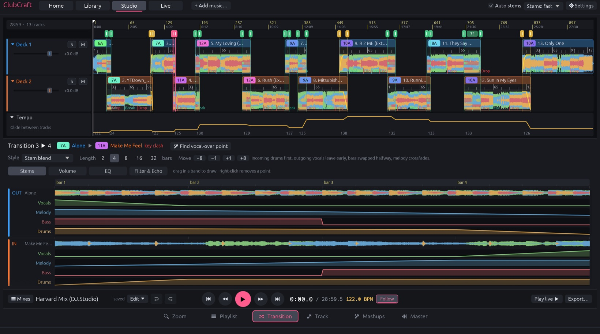
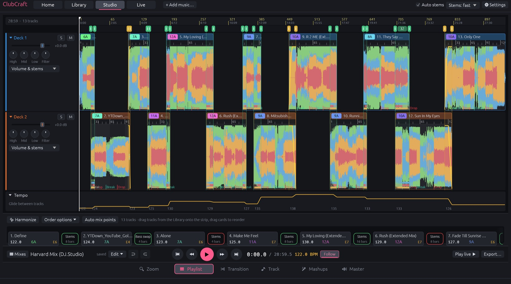
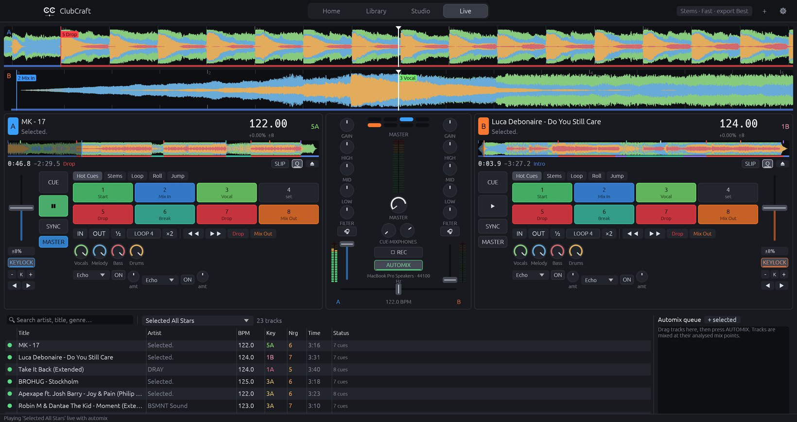
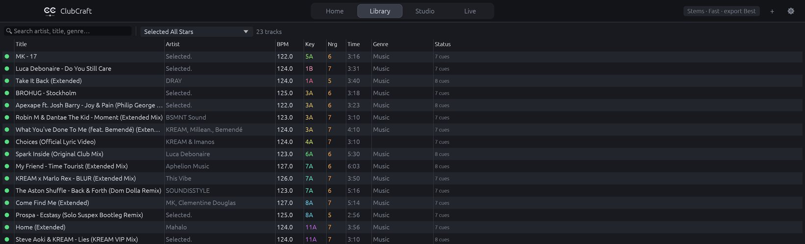
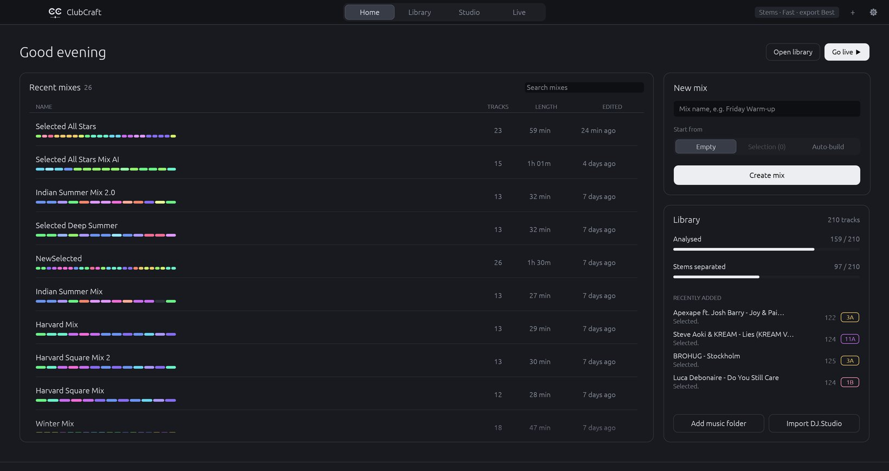
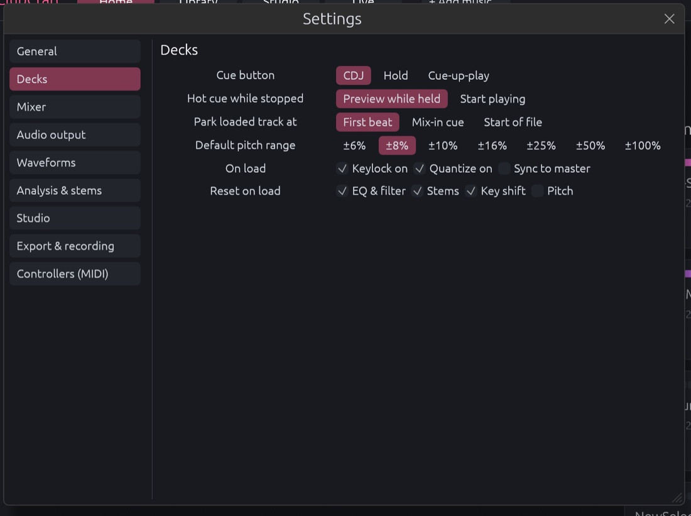
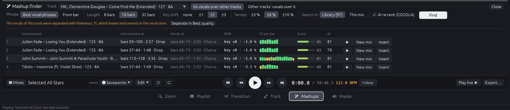

<p align="center">
  
</p>

<h1 align="center">ClubCraft</h1>

<p align="center">
  <b>DJ software with studio-grade stem separation: plan mixes like DJ.Studio, play them like VirtualDJ, rebuilt in Rust.</b><br>
  Separate tracks into vocals, melody, bass and drums, let the analysis find the beats, keys, drops and mix points,<br>
  design beat-matched transitions in the studio, then take the same mix out on the live decks.
</p>

<p align="center">
  
  
  
  
  
</p>

<br>

<p align="center">
  
  <br>
  <sub>A 28-minute mix in the studio, with the stem blend between two tracks open in the transition editor.</sub>
</p>

<p align="center">
  <a href="#features">Features</a> ·
  <a href="#everything-in-the-box">Everything in the box</a> ·
  <a href="#stems-without-compromise">Stems</a> ·
  <a href="#analysis-that-knows-your-music">Analysis</a> ·
  <a href="#under-the-hood">Under the hood</a> ·
  <a href="#get-started">Get started</a> ·
  <a href="#downloads">Downloads</a>
</p>

<br>

<table>
  <tr>
    <td width="25%" valign="top">
      <h3>🎚️ Studio-grade stems</h3>
      Meta's HTDemucs and Mel-Band RoFormer run natively on the Apple GPU (CoreML) or any DX12 GPU (DirectML). On real tracks they match the PyTorch reference to more than 100 dB.
    </td>
    <td width="25%" valign="top">
      <h3>🧠 Cues that find themselves</h3>
      Every track gets a beat grid, key, energy, sections and eight hot cues: Start, Mix In, Vocal, Build, Drop, Break and Mix Out. You don't place a single marker.
    </td>
    <td width="25%" valign="top">
      <h3>🔁 Studio ↔ Live</h3>
      One library and one analysis. A mix designed in the studio plays on the live decks with the same mix points, and its auto cues are already on the pads.
    </td>
    <td width="25%" valign="top">
      <h3>⚡ Native and light</h3>
      A lock-free Rust audio engine: about 1.5 % CPU per deck with keylock, stems and FX. Mixes stream track by track, so a 28-minute export stays under 300 MB of memory.
    </td>
  </tr>
</table>

<br>

## Features

Every screenshot here is the real app at work on a mix imported from DJ.Studio. ClubCraft captures them itself through its developer control channel.

<table>
  <tr>
    <td width="50%" valign="top">
      
      <br>
      <sub>Two lanes, each with its own mixer, and the tempo gliding from 122 to 130 BPM across the mix.</sub>
      <h3>Design the whole set</h3>
      Drop tracks in and <b>✨ Harmonize</b> orders them by Camelot key, tempo and energy arc, using simulated annealing over the whole set. Mix-in and mix-out points come from the analysed structure, and transition lengths fit the intro and outro of each pair.
      <br><br>
      Slide tracks and transitions by bars, collapse lanes, solo or mute them, shape a lane with its EQ and filter, and render the result to WAV with a cue sheet, faster than real time. Everything else lives in a DJ.Studio-style bar at the bottom: the transport, plus tabs for Zoom, Playlist (a sortable track table with keys, harmonic matches, energy and BPM), Transition, Track, Mashups and Master. Two <b>sample lanes</b> take one-shots, loops and FX dropped from Finder. Drag across a track's waveform to select a range and right-click to copy it to a sample lane: the full sound, or just its drums, bass, melody, vocals, instrumental or drums + bass (⌘L, ⇧⌘1–6). The copy is stretched and key-shifted like the mix plays it, or you can save it as a WAV. Every edit can be undone.
    </td>
    <td width="50%" valign="top">
      
      <br>
      <sub>Two decks phase-locked at 122 BPM, every hot cue placed by the analysis.</sub>
      <h3>Then play it live</h3>
      VirtualDJ-style decks: CDJ cue logic, eight hot cues, loops and loop rolls, beat jump, slip, keylock, key shift and match key, sync with a phase meter, stem knobs and pads (acapella, instrumental, drums only), three-band EQ with kill, filter and beat-synced FX.
      <br><br>
      <b>Play live ▶</b> sends a studio mix to the decks and automix plays it at its planned mix points. Or drag tracks into the automix queue.
    </td>
  </tr>
  <tr>
    <td width="50%" valign="top">
      
      <br>
      <sub>The library: BPM, key, energy and cues for every analysed track.</sub>
      <h3>A library that analyses itself</h3>
      Drop a folder in and every track is analysed within about a second. Stems are separated on demand: when a transition needs them, when you export a mix, or for the whole library in the background if you switch that on. Sort and search by artist, title, BPM, key or energy, and drag tracks onto a deck or into a mix.
      <br><br>
      Imports your <b>DJ.Studio</b> projects, with their mix points, cues, transitions (every effect and drawn curve) and the stem automation on the tracks, and exports beat grids, keys, hot cues and automix points to <b>VirtualDJ</b>.
    </td>
    <td width="50%" valign="top">
      
      <br>
      <sub>The home page: new mix, quick actions and recent mixes with their key colours.</sub>
      <h3>Start anywhere</h3>
      Start a mix from scratch, from selected tracks, from a playlist, or let ClubCraft auto-build one from analysed tracks in a BPM range. Recent mixes show their length, track count and harmonic journey at a glance.
    </td>
  </tr>
  <tr>
    <td width="50%" valign="top">
      
      <br>
      <sub>Settings ▸ Decks, one of nine tabs (⌘, from the menu bar).</sub>
      <h3>Behaves the way you play</h3>
      Cue modes (CDJ, hold, cue-up-play), hot cue behaviour, load position, pitch ranges, crossfader and fader curves, auto gain and limiter, key notation (Camelot, Open Key or musical), waveform colours, BPM range, stem quality, default transitions and export formats.
    </td>
    <td width="50%" valign="top">
      <h3>Transitions you can read</h3>
      Pick a preset (Stem blend, Bass swap, Crossfade, Vocal over, Mashup, Filter out, Echo out, Cut), then adjust it the way DJ.Studio does it: for every stem <b>Off · Swap · Crossfade · Full</b>, the same for each EQ band, plus volume, filter and echo choices. When a transition is selected, the timeline splits both tracks into stem rows with their level lines. <b>Curves</b> lets you draw any parameter by hand. Lock a transition and harmonizing or recomputing mix points leaves it alone.
      <br><br>
      Until a track has stems, its stem curves are imitated with volume and EQ: each transition keeps its own shape, and the timeline shows it marked "no stems". <b>Stems missing</b> in the transport bar separates them for the whole mix in one click, and an export separates the ones it needs first. The editor also warns when the outgoing track fades out before its transition ends, or when the incoming track comes in much quieter.
      <h3>Keyboard first</h3>
      <b>Studio:</b> Space play · ← → bar (⇧ 8 bars) · [ ] transitions · F follow · + − zoom · ⌘Z / ⇧⌘Z undo / redo · ⌘S save.<br>
      <b>Live:</b> Z X C and M , . cue/play/sync · 1–8 hot cues (⇧ deck B) · ← → crossfader.<br>
      MIDI controllers map with MIDI learn.
    </td>
  </tr>
</table>

<br>

## Find mashups

<p align="center"></p>

Want the vocals of one track over another? The **🎤 Mashups** tab of the studio's bottom bar opens the finder. You can also start it from the track inspector, the library's context menu or ⇧⌘M. It searches your library for the instrumentals that carry those vocals, and tells you where.

- **Where it fits, bar by bar.** For every 16-bar placement it compares the vocal notes with the instrumental's bass and chords, using a consonance table that knows a vocal a major seventh above a chord is colour but a semitone above it clashes. It also weighs masking by a loud melody in the vocal range, leftover vocals of the backing track, and the tempo and key change needed. On real tracks the original pairing beats its own ±1–2 semitone shifts 93 % of the time, where plain key matching or chroma similarity (as in AutoMashUpper) manages 84 %.
- **An AI second opinion.** The best 20 candidates are rendered as the mix would play them, with the vocals shifted and stretched, and [COCOLA](https://github.com/gladia-research-group/cocola) (ICASSP 2025), a network trained on separated stems, listens to each. Blending both scores ranks the right match higher than either alone (84 % against random placements, from 78 %).
- **Hear it, then use it.** ▶ plays the vocals over the instrumental straight away. **New mix** makes a two-track mashup, and **Insert** puts the instrumental after the vocal track in the open mix. Both use the new **Mashup** transition: the instrumentals swap within a bar and the vocals keep singing for the whole phrase.
- **For transitions too.** In the transition editor, **🎤 Find vocal-over point** finds where the outgoing vocals sound best over the incoming track and sets the transition with one click.

## Everything in the box

<table>
  <tr>
    <td width="33%" valign="top">
      <h4>🎚️ Stems</h4>
      Fast (htdemucs), High (htdemucs_ft, four fine-tuned models) and Best (Mel-Band RoFormer vocals + htdemucs_ft) · CoreML GPU on macOS, DirectML on Windows, ONNX Runtime CPU fallback · progressive separation while a track plays · 8-channel FLAC stem cache · residual playback, so unity stems are bit-exact with the original
    </td>
    <td width="33%" valign="top">
      <h4>🧠 Analysis</h4>
      Constant-tempo beat grid fitted to about 1 ms · downbeat and phrase alignment · key detection (EDM-tuned profiles) · EBU R128 loudness and auto gain · energy 1–10 · sections (intro, verse, build, drop, break, outro) · 8 hot cues and phrase markers · optional All-In-One structure model
    </td>
    <td width="33%" valign="top">
      <h4>🗺️ Studio</h4>
      Harmonic ordering (key, BPM, energy arc) · automatic mix points · beat-locked timeline with a tempo glide or a fixed BPM · per-lane gain, solo, mute, EQ and filter · 7 transition styles plus custom curves · lazy, memory-bounded preview · WAV export (16/24/32-bit) with a cue sheet
    </td>
  </tr>
  <tr>
    <td width="33%" valign="top">
      <h4>🎛️ Decks</h4>
      Two live decks (plus two for the studio preview) · CDJ, hold and cue-up-play cue modes · 8 hot cues · loops from 1/32 to 32 beats, loop roll, slip · beat jump · keylock (Signalsmith Stretch) and key shift · sync with a phase meter · jog and scratch · brake and spinback
    </td>
    <td width="33%" valign="top">
      <h4>🔊 Mixer and FX</h4>
      3-band isolator EQ with kill · resonant one-knob filter · crossfader curves · headphone cue on outputs 3/4 or a split cable · master limiter · recording · echo, ping-pong, reverb, flanger, filter LFO, gate, roll, bitcrusher, brake · per-stem echo-out
    </td>
    <td width="33%" valign="top">
      <h4>🔗 Interop</h4>
      DJ.Studio project and cue import (read-only) · VirtualDJ <code>database.xml</code> export and import (merges safely and keeps a backup) · MIDI learn mappings in JSON · native macOS menu bar
    </td>
  </tr>
</table>

<br>

## Stems without compromise

Stem quality is the heart of ClubCraft. The separation runs the original networks: no lighter re-trained model, no cloud service.

- **Faithful to the reference.** The neural cores of HTDemucs and Mel-Band RoFormer are exported once (`tools/model-export`). The STFT, segmenting, overlap-add, shift trick and bag-of-models weighting are reimplemented in Rust to match `demucs.apply` exactly. On real house tracks, full-pipeline output matches Python Demucs at **110–128 dB** on CoreML, so any difference is inaudible.
- **Best quality.** Mel-Band RoFormer separates the vocals, about 2.7 dB better than htdemucs_ft on public benchmarks. htdemucs_ft then splits the remaining instrumental into drums and bass, and melody is what's left. The four stems still sum back to the mix exactly.
- **Speed** on an M1 Pro, for a 5-minute track:

  | Quality | Models | Time |
  |---|---|---|
  | Fast | htdemucs | ≈ 17 s |
  | High | htdemucs_ft (4 models) | ≈ 80 s |
  | Best | Mel-Band RoFormer + htdemucs_ft | ≈ 3.5 min |

  A track loaded on a deck before it was separated gets usable stems under the playhead in about a second.
- **Light on memory.** Stems are held as 16-bit samples with one scale per stem, heavy jobs never overlap, and idle models are released. A full Best separation peaks at about 2 GB.

## Analysis that knows your music

The analysis was tuned and checked against DJ.Studio's and Mixed In Key's results for 137 real tracks (`cargo run --release -p clubcraft-analysis --example eval`).

| | Result |
|---|---|
| BPM within 0.05 | 99.3 % |
| Beat phase within 15 ms | 98.5 % |
| Downbeat (bar phase) | 96.3 % |
| Key exact or relative | 86.9 % |
| Time per track (without the deep structure model) | ≈ 0.1–0.5 s |

The cue generator places Mix In at least 32 beats before the first drop or vocal, on a phrase line. Mix Out goes on the outro, or 32 to 64 beats before the music ends. Drops land on their downbeat. The studio aligns each incoming Mix In with the outgoing Mix Out, which is why mixes line up without any manual work.

## Under the hood

- **Six crates:** `core` (data model, SQLite library, planner, beat-locked mix timeline), `audio` (decoding, tags, resampling), `stems`, `analysis`, `engine` (real-time audio, mix conductor, renderer, MIDI) and `app` (egui).
- **Real-time engine:** a lock-free command queue in, a triple-buffered state snapshot out, and nothing allocated or locked on the audio thread. Stems are mixed before the stretcher, so each deck needs only one time-stretcher.
- **One conductor:** the studio preview, live automix and offline render all run the same code path, so what you hear in the preview is exactly what you export.
- **Exact timing:** tempo is piecewise linear in mix beats and integrated analytically, which keeps overlapping tracks beat-locked to within a millisecond.
- **Clean-room:** ClubCraft is independent. Behaviour and file formats of DJ.Studio and VirtualDJ were only studied for interoperability (importing projects, exporting cues). No code, models or assets from either product are used.
- **Tested:** 74 unit and integration tests, plus evaluations against Python Demucs and a 137-track analysis corpus.

## Talk to it: built-in MCP server

ClubCraft includes a [Model Context Protocol](https://modelcontextprotocol.io) server, so Claude or any other MCP client can work with your library in plain language. For example: *"build a 45-minute warm-up from my 120–124 BPM tracks with energy rising, use stem blends, and export it"*. It runs headless on the same library as the app, and changes appear in an open ClubCraft window right away.

```sh
# Claude Code
claude mcp add clubcraft -- /Applications/ClubCraft.app/Contents/MacOS/ClubCraft mcp
```

For Claude Desktop or other clients, add it to the MCP config (on Windows, the command is the path to `ClubCraft.exe`):

```json
{ "mcpServers": { "clubcraft": { "command": "/Applications/ClubCraft.app/Contents/MacOS/ClubCraft", "args": ["mcp"] } } }
```

| Tools | |
|---|---|
| Library | `library_overview`, `search_tracks` (text, BPM, key, harmonic match, energy, stems), `get_track` (grid, key, loudness, sections, hot cues), `import_tracks` |
| Processing | `analyze_tracks`, `separate_stems` (Fast to Best, with progress and cancel), `set_hot_cue` |
| Studio | `list_mixes`, `get_mix`, `create_mix` (harmonic ordering), `edit_mix`, `set_transition`, `set_mix_points` |
| Mashups | `find_mashups` (where the vocals of one track fit over other tracks' instrumentals), `create_mashup_mix` |
| Export | `export_mix` (WAV plus cue sheet), `export_virtualdj` (grids, keys and cues into `database.xml`) |

Separation and rendering share a lock with the app, so only one heavy job runs at a time.

## Get started

```sh
git clone https://github.com/beneaze/ClubCraft
cd ClubCraft
cargo run --release -p clubcraft          # the app
cargo test -p clubcraft-core -p clubcraft-engine
tools/bundle-macos.sh                     # target/ClubCraft.app, models included
```

The separation models (≈ 3 GB) aren't in git. Export them once from the official checkpoints with the script in [`tools/model-export`](tools/model-export); [`models/README.md`](models/README.md) has the commands. On Windows, use `.\tools\package-windows.ps1`.

Your library, stems, waveforms, exports and recordings live in `~/Music/ClubCraft` (`CLUBCRAFT_HOME` changes that).

> [!IMPORTANT]
> **Status:** ClubCraft is in early alpha. The studio, live decks, stems and analysis work end to end and are tested, but expect rough edges. Back up your music folders, and keep VirtualDJ closed while ClubCraft writes to its database.

## Downloads

**[Latest release: v0.1.1](../../releases/tag/v0.1.1)**

| Platform | File | Notes |
|---|---|---|
| macOS 13+ (Apple Silicon) | `ClubCraft-0.1.1-macos-arm64.dmg` | All CoreML stem models and the COCOLA mashup model bundled. Ad-hoc signed: right-click › Open the first time |
| Windows 10/11 (x64) | `ClubCraft-0.1.1-windows-x64.zip` | `ClubCraft.exe`, `DirectML.dll`, the ONNX stem models and the COCOLA mashup model |

Development builds: `tools/bundle-macos.sh` (macOS), and the `ClubCraft-windows-x64` artifact of every [CI run](../../actions) (Windows, without models).

## License

ClubCraft is dual-licensed under [MIT](LICENSE-MIT) or [Apache-2.0](LICENSE-APACHE). The Demucs weights are MIT (Meta Platforms). The Mel-Band RoFormer checkpoint (Kimberley Jensen) and ZFTurbo's implementation are MIT, and so is Signalsmith Stretch. COCOLA (Ciranni et al.) is MIT; its checkpoint was trained on datasets that include MoisesDB, which is licensed for non-commercial research. DJ.Studio and VirtualDJ are trademarks of their respective owners, and ClubCraft is not affiliated with either.
